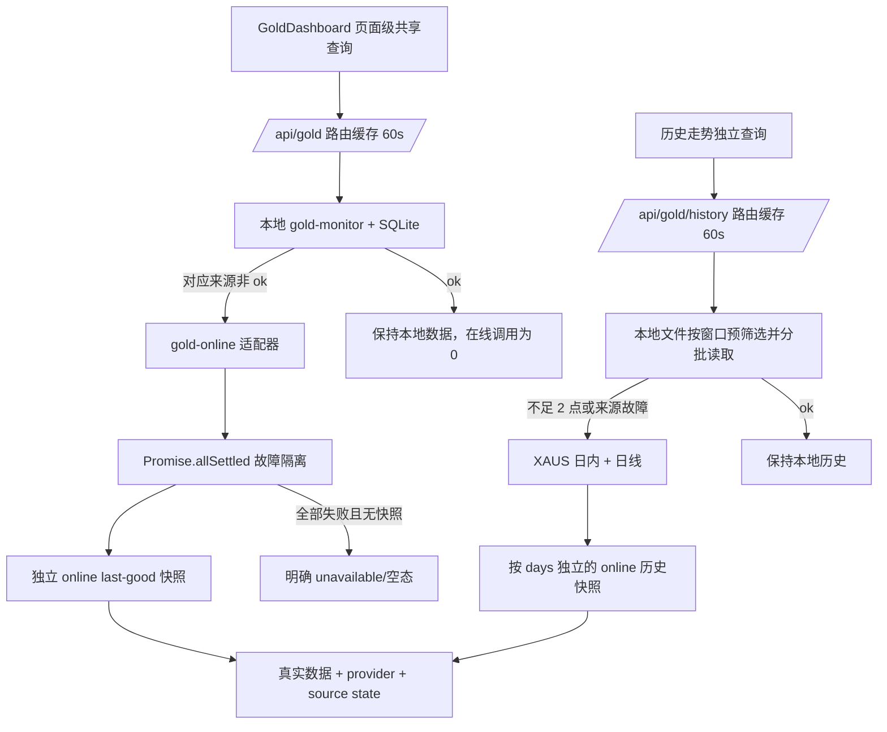

# 黄金观察数据源深度研究与修复报告

日期：2026-11-26  
范围：`/gold` 页面、`/api/gold`、`/api/gold/history?days=1|7|30`

## 1. 执行摘要

黄金观察此前所有 API 失败的根因不是单一上游接口失效，而是数据引擎只有两个本机资产入口：

- `gold-monitor` 生成的 `gold_data_*.json`；
- `central-bank-gold` 的 SQLite 数据库。

当前机器没有这些文件，也没有设置 `GOLD_DATA_DIR` 或 `GOLD_CB_DB_PATH`。默认路径又是 Linux 部署路径，因此在 macOS 本地运行时，页面没有可用数据源。这是**资产位置假设错误加上缺少独立在线回退**，不是页面自身能够修复的问题。

本次实现了以下链路：

> 本地资产优先 → 真实在线源回退 → 独立 last-good 快照 → 明确空态

修复后，本地资产缺失不再导致整页失效；现货、历史、美债、实际利率、CPI、Fed、央行储备与新闻均由真实来源恢复。任何在线字段都不会被硬编码行情或空数组伪装替代。

## 2. 数据源评估与选择

| 面板 | 采用来源 | 实测结果 | 新鲜度与限制 |
|---|---|---|---|
| 金价现货 | [XAUS Spot](https://xaus.com/api/v1/spot?currency=CNY&compact=1) | 同次响应提供 USD/oz、CNY/oz、汇率、`price_as_of` 和 `data_state` | 指示性中间价，不是可成交或结算报价；文档要求至少缓存 60 秒 |
| 现货备用 | [Gold API](https://api.gold-api.com/price/XAU) | XAUS 失败时可提供真实 USD 报价与更新时间 | 不提供本次所需 CNY 字段；缺失时不伪造汇率换算 |
| 24H/7D/30D 历史 | [XAUS Intraday](https://xaus.com/api/v1/intraday?symbol=xau&hours=48) + [Daily History](https://xaus.com/api/v1/history) | 日内为 Unix 秒时间戳，日线最长约 5 年；可合并、去重和降采样 | 日内保留期与采样覆盖由上游决定；保留上游 `data_state` |
| 名义美债 | 美国财政部官方年度 CSV | 实测返回 1M、3M、6M、1Y、2Y、3Y、5Y、7Y、10Y、20Y、30Y | 交易日日频，不应标成实时 |
| 实际美债 | 美国财政部官方实际收益率 CSV | 实测返回 5Y、7Y、10Y、20Y、30Y | 与名义曲线按同日期、同期限计算盈亏平衡 |
| CPI/核心 CPI | FRED `CPIAUCSL`、`CPILFESL`，`transformation=pc1` | 可取到最后非空同比观测 | 月度公布且可能修订；空值不能转成 0 或前向填充 |
| 有效联邦基金利率 | FRED `DFF` | 可取到最后非空日频观测 | 与美联储目标区间不是同一口径 |
| 央行储备 | [XAUS Reserves](https://xaus.com/api/v1/reserves) | 提供国家、机构、吨位、上期吨位、参考期和排名 | 当前响应自带 `stale`；各国报告期不同，不能伪装为统一月份交易 |
| 央行口径核验 | [世界黄金协会 reserves 页面](https://www.gold.org/goldhub/data/gold-reserves-by-country) | 说明数据来自 IMF IFS、央行及 WGC 修订 | IFS 通常滞后两个月，迟报国家可能更旧 |
| 新闻主源 | [CNBC RSS](https://www.cnbc.com/id/10000664/device/rss/rss.html) | 当前可访问并持续更新；按黄金与宏观关键词、发布日期筛选 | 属筛选后的宏观/黄金新闻，不冒充纯黄金专线 |
| 新闻备用 | Google News RSS、世界黄金协会 RSS | Google 在当前本机网络实测超时；WGC 可访问但混有旧内容 | 所有 RSS 均校验日期；WGC 额外过滤旧闻和无关条目 |

### XAUS 使用依据

[XAUS API 文档](https://xaus.com/api/)明确提供无需密钥的现货、日线、日内和央行储备端点。文档还定义了 `fresh/stale/unavailable` 状态、`as_of` 和缓存行为。其实现口径与本次需求一致：真实快照可以降级返回，但不能模拟价格。

### 美国财政部使用依据

美国财政部的[利率统计说明](https://home.treasury.gov/policy-issues/financing-the-government/interest-rate-statistics)和[收益率曲线方法](https://home.treasury.gov/policy-issues/financing-the-government/interest-rate-statistics/treasury-yield-curve-methodology)说明名义与实际曲线均为交易日发布。实现使用官方年度 CSV：

- `type=daily_treasury_yield_curve`
- `type=daily_treasury_real_yield_curve`

盈亏平衡通胀使用同一日期、同一期限的 `nominal - real`。若最新名义日期与最新实际日期不同，最新曲线仍分别展示，但盈亏平衡只使用可匹配的日期。

### FRED 使用依据

- [DFF：Federal Funds Effective Rate](https://fred.stlouisfed.org/series/DFF)
- [CPIAUCSL：Consumer Price Index](https://fred.stlouisfed.org/series/CPIAUCSL)
- [CPILFESL：Core CPI](https://fred.stlouisfed.org/series/CPILFESL)

实现通过 `fredgraph.csv` 读取，不要求 API key。该入口不是带稳定性承诺的正式 API，因此代码校验表头、日期、有限数值和空单元格，不把 HTTP 200 等同于有效数据。

## 3. 修复后的架构



### 缓存与快照边界

- 路由层继续负责 60 秒缓存、在途请求合并和失败退避。
- 在线监控、央行和历史使用独立快照键：
  - `gold:online-monitor`
  - `gold:online-central-bank`
  - `gold:online-history:${days}`
- 在线快照不与本地 `gold:monitor`、`gold:central-bank`、`gold:history:${days}` 混写。
- 快照或上游 stale 数据使用 15 秒短 TTL，以便恢复后更快回到新鲜源。
- last-good 仍遵循现有 7 天最大年龄，不无限期展示陈旧数据。

### 故障隔离

现货、财政部、FRED、新闻通过 `Promise.allSettled` 独立聚合。新闻失败不会清空金价；实际收益率失败不会阻断名义曲线；单个 FRED 序列失败不会阻断其他序列。

部分字段失败时，可以从最近在线快照或本地 stale 数据补齐，并标记 `partial/stale` 和稳定原因码。全部失败且没有快照时，仍返回明确不可用状态。

## 4. 前端口径修正

- `GoldStamp` 不再硬编码“数据来自 gold-monitor 管道”，而是展示各面板真实 provider。
- 金价、宏观和央行的 stale 状态分别读取自己的 source state，避免央行延迟导致新鲜金价也被标成缓存。
- 美债“实时(FRED)”改为最新曲线及真实来源。
- “央行购金动态”改为“央行储备变动”；在线变化口径为 `t - prev`，即“较上期储备变化”。
- 实际利率期限改为数值排序，顺序为 5、7、10、20、30，而不是字典序。
- 历史页脚区分 XAUS 5 分钟日内、日线合并和本地采样。
- 新闻显示发布方与发布日期；旧闻、无日期和无关条目不会进入列表。
- 保留已有页面级聚合查询和前端 GET 在途合并，避免 React StrictMode 开发环境重复请求。

## 5. 真实验证结果

验证环境为本机临时开发服务，未使用测试 fixture：

| 项目 | 实测结果 |
|---|---|
| 黄金聚合 | `source=online`，USD/CNY 现货、财政部、FRED、央行均返回真实数据 |
| 美债 | 11 个名义期限，最新交易日 2026-11-25 |
| 实际曲线 | 5Y/7Y/10Y/20Y/30Y；10Y 盈亏平衡由同日名义与实际利率计算 |
| CPI | 最后非空观测为 2026-09；页面显示 CPI 3.72%、核心 CPI 2.57% |
| Fed | 最后非空有效利率日期 2026-11-24，页面显示 3.88% |
| 央行 | TOP10 为 10 个国家，储备变化 15 条；上游 stale 被明确透传 |
| 新闻 | CNBC 返回 4 条通过日期与相关性筛选的宏观条目，并显示日期 |
| 历史 | 24H、7D、30D 均为 `status=ok`；7D 实测原始 578 点，最多返回 200 点 |
| 页面 | 8 个面板均有真实内容；24H/30D 切换成功 |
| 首屏网络 | `/api/gold` 与 `/api/gold/history?days=7` 各 1 次；后续轮询请求不属于首屏重复 |

页面验证使用 DOM 和网络捕获，未把未完成的像素截图宣称为视觉验收。

## 6. 自动化验证

最终执行：

```bash
npm run lint
npm run build
npm test
```

结果：

- ESLint：通过；
- TypeScript 与 Vite 生产构建：通过；
- 前端：51 项通过；
- 服务端：57 项通过；
- 合计：108 项通过。

黄金专项覆盖：

1. 本地资产缺失时在线恢复所有面板；
2. 本地资产有效时在线调用次数为 0；
3. 央行 stale 透传与机构汇总过滤；
4. FRED 空值不造 0、不前向填充；
5. RSS 实体解码；
6. CNBC 旧闻与无关条目过滤；
7. 盈亏平衡同日期、同期限匹配；
8. 新闻故障隔离；
9. 历史上游失败后的独立 last-good；
10. XAUS 现货失败后的 Gold API 回退；
11. 本地历史窗口外文件零读取；
12. 本地文件/SQLite 原有行为保持。

## 7. 剩余边界与后续建议

- XAUS 适合作为指示性行情与研究仪表盘来源，不应作为交易结算源。
- 财政部、CPI、央行储备本身是日频/月频数据，页面应继续展示观测日期，而非追求伪实时。
- Google News RSS 在当前网络下不可用，因此只保留为备用，不作为唯一依赖。
- FRED 图表 CSV 与 RSS 都可能变更结构；现有校验会失败并降级，后续可增加结构变化告警。
- 若部署环境拥有本地资产，建议显式配置 `GOLD_DATA_DIR` 与 `GOLD_CB_DB_PATH`，避免依赖 Linux 默认路径。
- 若需要央行历史月度交易而不是“当前储备较上期变化”，仍应恢复专门的历史数据库或接入正式 WGC/IMF 数据产品。

## 8. 主要代码位置

- `server/sources/gold-online.cjs`：在线适配器、CSV/RSS 校验、历史合并。
- `server/sources/gold.cjs`：本地优先、在线回退、独立快照与来源状态。
- `server/index.cjs`：共享 `fetchTextAny` 注入与路由缓存。
- `server/gold-online.test.cjs`：固定样本测试，不访问真实网络。
- `src/GoldDashboard.tsx`：来源、新鲜度、日期与采样口径展示。
- `src/lib/api.ts`：增量响应类型与在途 GET 合并。
